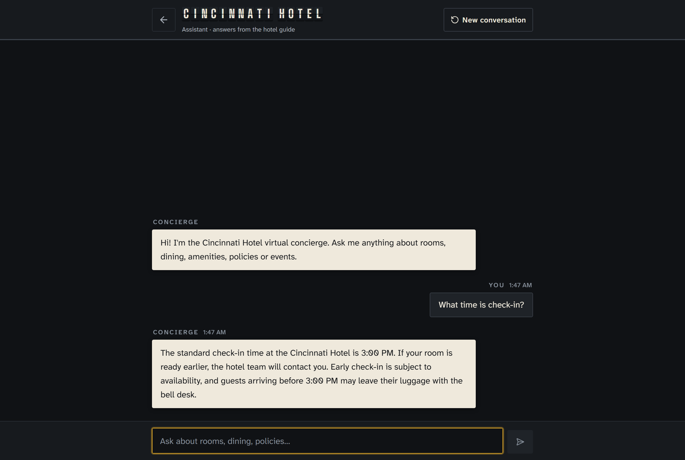
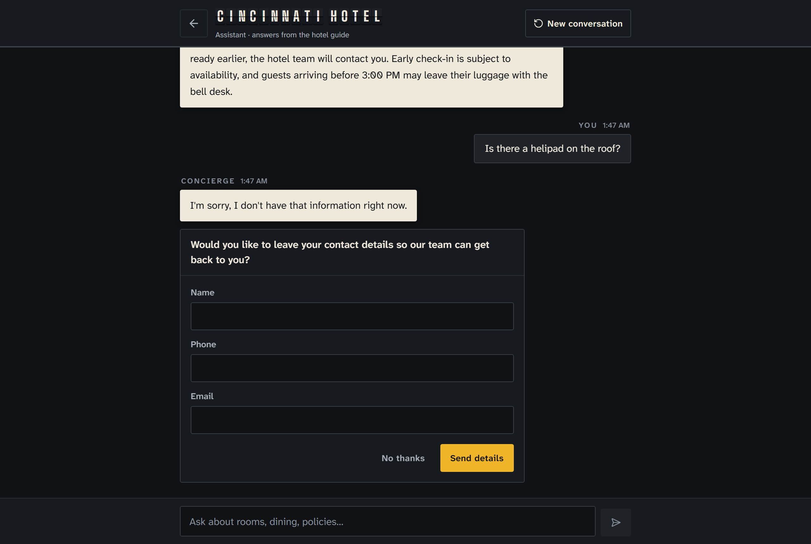
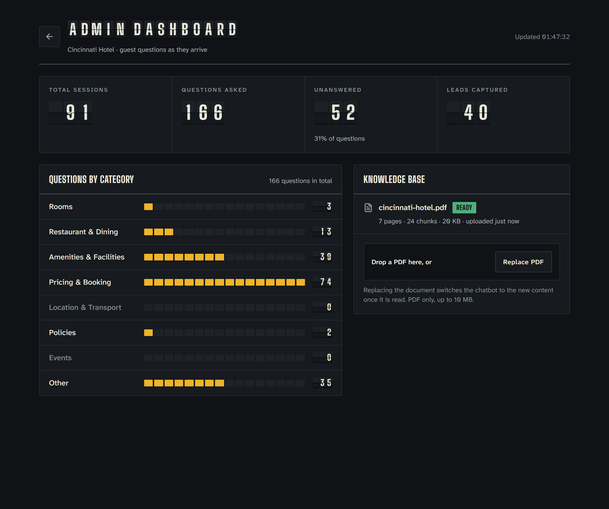

# Cincinnati Hotel Chatbot

**Live:** <https://cincinnatihotel.tristanjamestolentino.com> · **n8n:** <https://cincinnatihotelbackend.tristanjamestolentino.com> ·
**Reviewer guide:** [`docs/SUBMISSION.md`](docs/SUBMISSION.md)

| Guest chat | Fallback + contact form | Admin dashboard |
|---|---|---|
|  |  |  |

A hotel information assistant for guests. It answers **only** from the PDF an admin uploads. When it cannot answer,
it offers a contact form, and the conversation summary is emailed to the hotel team. Admins get a live dashboard of
sessions, questions, unanswered questions, leads and categories, which updates without a page reload.

Built for the Tauga AI entrance task. The brief is in [`docs/Cincinnati-Hotel-Chatbot-Entrance-Task.pdf`](docs/Cincinnati-Hotel-Chatbot-Entrance-Task.pdf).

## Why it is built this way

- **Grounded answers.** Retrieval is scoped to the active document. The model gets at most six excerpts and must reply
  with the canned sentence when they do not contain the answer, or when the question is not about the hotel. When
  nothing is retrieved, the model is not called. A half-answerable question gets the part the PDF covers plus the
  contact form for the rest.
- **All AI in n8n.** Ingest, retrieval, answering, classification and the lead email are visible n8n workflows. The
  API never calls OpenAI or Resend, so prompts and models can be inspected in the editor.
- **Real-time admin.** Changes are pushed over Server-Sent Events and fall back to polling if the stream is interrupted.
- **Safe replacement.** A new PDF is ingested in the background; the old one keeps answering until the new one is
  ready, and its chunks are removed in the same transaction that activates the new document.
- **One command to run.** `docker compose up` at the repo root starts Postgres with pgvector, n8n, the API and the web
  app. Production adds a Cloudflare Tunnel, so the VPS needs no open ports.

## Stack

React 19 with Vite and Tailwind v4 (web) · Fastify 5 with TypeScript (API) · n8n 2.45.5 (all AI orchestration) ·
Postgres 16 with pgvector · OpenAI (`text-embedding-3-small`, `gpt-4.1-mini`) · Resend (email) · Docker Compose ·
nginx · Cloudflare Tunnel · Turborepo + pnpm workspaces · Vitest · Playwright.

## Repository layout

```
compose.yml             all services (postgres, n8n, api, web, cloudflared); build context is the repo root
compose.override.yml    dev only: publishes host ports, plain-HTTP n8n. Auto-merged by `docker compose`
turbo.json              task pipeline for build / typecheck / lint / test / dev / e2e
apps/api                Fastify API (Vitest tests in apps/api/test)
apps/web                React app served by nginx (Vitest tests next to src/lib)
apps/n8n                n8n workflows, prompts, credential template, import script, workflow contract tests
e2e/                    Playwright end-to-end tests (HTTP smoke, browser flows, real-mode accuracy + lead email)
migrations/             Postgres init scripts (n8n database, schema with pgvector); run on an empty volume
docs/                   architecture, PDF pipeline, dashboard, runbook, submission notes, sample PDF
```

## Setup

### 1. Prerequisites

| Need | For |
|---|---|
| Docker with Compose v2 (`docker compose version`) | Running the stack |
| Node.js 22+ and pnpm 11 (`corepack enable`) | Tests, `pnpm dev`, the n8n import shortcut |
| Git Bash on Windows (or bash on Linux/macOS), `jq`, `envsubst` (gettext) | `pnpm n8n:import` |
| OpenAI and Resend API keys | Real mode only. Mock mode needs no keys |

### 2. Configure

```bash
cp .env.example .env
pnpm install
```

Fill `.env`:

- Always: `POSTGRES_PASSWORD`, `N8N_ENCRYPTION_KEY`, `N8N_WEBHOOK_SECRET` (`openssl rand -hex 24` for the two keys).
  Keep `N8N_VERSION` pinned.
- Mock mode: `N8N_MOCK=1`. The API answers in-process, so no keys are needed.
- Real mode: `N8N_MOCK=0`, `OPENAI_API_KEY`, `RESEND_API_KEY`, `EMAIL_FROM` (a domain verified in Resend) and `LEAD_TO`
  set to **your own inbox** while testing.
- If ports 3000 or 5432 are taken on your machine, set `API_HOST_PORT` / `POSTGRES_HOST_PORT`.

### 3. Start the stack

Run every command from the repo root. Compose reads `compose.yml`, merges `compose.override.yml` and loads `.env`
automatically, so no `-f` or `--env-file` flags are needed.

```bash
docker compose up -d --build --wait
```

| URL | What |
|---|---|
| <http://localhost:8080> | Guest chat (landing page → **Regular User**) |
| <http://localhost:8080/admin> | Admin dashboard and PDF upload |
| <http://localhost:5678> | n8n editor |
| <http://localhost:8080/api/health> | API health (`n8n: "mock"` in mock mode) |

On Windows, if another program holds IPv4 port 8080, use <http://[::1]:8080>.

### 4. Real mode only: connect n8n

1. Open <http://localhost:5678> and create the n8n owner account (once).
2. Import the credentials and workflows from `.env` and publish them: `pnpm n8n:import`.
3. Upload `docs/sample/cincinnati-hotel.pdf` at <http://localhost:8080/admin> and wait for **Ready** (ingest runs in the background)
   (regenerate the PDF with `pnpm sample:pdf` if needed).

### 5. Run the tests

```bash
pnpm test                       # Vitest in api, web and n8n (no stack needed)
pnpm --filter e2e browsers      # once per machine: installs Chromium for Playwright
pnpm e2e                        # Playwright against the running stack (mock or real)
pnpm e2e:real                   # + accuracy set and lead webhook (real mode; sends real email to LEAD_TO)
```

`pnpm e2e` uploads the sample PDF, walks the HTTP contract (chat, fallback, lead, stats, SSE) and runs the browser
flows. Test another deployment with `E2E_BASE_URL=https://hotel.example.com pnpm e2e`. The tests are described in
[`docs/RUNBOOK.md`](docs/RUNBOOK.md#tests).

## Docker Compose cheat sheet

| Task | Command |
|---|---|
| Build and start everything, wait until healthy | `docker compose up -d --build --wait` |
| Status and health | `docker compose ps` |
| Follow logs | `docker compose logs -f api n8n` |
| Start only the backing services (for `pnpm dev`) | `docker compose up -d postgres n8n` |
| Rebuild one service after a code change | `docker compose up -d --build api` (or `web`) |
| Apply a changed `.env` value | `docker compose up -d api` (recreates the container if its config changed) |
| One-off mock run without editing `.env` | `N8N_MOCK=1 docker compose up -d api` |
| Restart a service | `docker compose restart n8n` |
| Shell into the database | `docker compose exec postgres psql -U hotel -d hotel` |
| List active n8n workflows | `docker compose exec n8n n8n list:workflow --active=true --onlyId` |
| Export workflows after editing in the UI | `docker compose exec -T n8n n8n export:workflow --all --separate --output=/tmp/wf` then `docker compose cp n8n:/tmp/wf/. apps/n8n/workflows/` |
| Stop (keep data) | `docker compose down` |
| Stop and **delete all data** (database, n8n, uploads) | `docker compose down -v` |
| Show the merged config | `docker compose config` |

**Production (VPS).** Never let the dev override in: always pass `-f compose.yml`, or put `COMPOSE_FILE=compose.yml` in
the VPS `.env` so plain `docker compose` uses the production file only.

```bash
git pull --ff-only
docker compose -f compose.yml --profile tunnel up -d --build --wait  # build, start with the tunnel, wait healthy
bash apps/n8n/scripts/import.sh --prod                              # first deploy, after creating the n8n owner
docker compose -f compose.yml logs -f api
```

The full deploy and troubleshooting are in [`docs/RUNBOOK.md`](docs/RUNBOOK.md#deploy-to-a-vps); the tunnel setup is in
[`docs/CLOUDFLARE-TUNNEL.md`](docs/CLOUDFLARE-TUNNEL.md).

## Development with hot reload

```bash
docker compose up -d postgres n8n
pnpm dev                        # turbo: api on :3000 (tsx watch), web on :5173 (vite, proxies /api)
```

The API does not read `.env` itself. Export the variables it needs first; the exact lines are in
[`docs/RUNBOOK.md`](docs/RUNBOOK.md#development-without-containers).

## Workspace commands (Turborepo)

| Command | What it runs |
|---|---|
| `pnpm build` | `tsc` for the API, `vite build` for the web app (cached) |
| `pnpm typecheck` | `tsc --noEmit` in api, web and e2e |
| `pnpm lint` | ESLint in the web app, `tsc --noEmit` in the API |
| `pnpm test` | Vitest in api, web and n8n |
| `pnpm --filter api test` | One package only (`web`, `n8n`, `e2e` work the same) |
| `pnpm e2e` / `pnpm e2e:real` | Playwright in `e2e` |
| `pnpm n8n:import` | `apps/n8n/scripts/import.sh` (dev compose files) |

## Documentation

| Document | What it covers |
|---|---|
| [`docs/ARCHITECTURE.md`](docs/ARCHITECTURE.md) | Architecture diagram, technology choices, database schema, API contract, n8n workflow contracts, compose and environment. The source of truth |
| [`docs/PDF-PROCESSING.md`](docs/PDF-PROCESSING.md) | How a PDF is ingested (download, split, embed, store, purge), how a question is answered from it, and how "I don't know" is decided |
| [`docs/ADMIN-DASHBOARD.md`](docs/ADMIN-DASHBOARD.md) | Dashboard design, what each statistic counts, and the real-time data flow with its polling fallback |
| [`docs/RUNBOOK.md`](docs/RUNBOOK.md) | Prerequisites, environment table, local runs, n8n import, tests, VPS deploy, extending the app, troubleshooting |
| [`apps/n8n/README.md`](apps/n8n/README.md) | Node-by-node reference for the three workflows, credentials, import and export |
| [`docs/CLOUDFLARE-TUNNEL.md`](docs/CLOUDFLARE-TUNNEL.md) | Public access through a Cloudflare Tunnel, or ngrok |
| [`docs/SUBMISSION.md`](docs/SUBMISSION.md) | Reviewer guide: live links, a 60-second test script, how the brief maps to the code |
| [`.claude/CLAUDE.md`](.claude/CLAUDE.md) | AI-assisted development conventions: the rules the coding agents followed in this repository |
