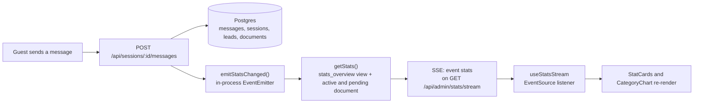

# Admin dashboard

The `/admin` page shows how the chatbot is being used and lets an admin replace the knowledge base PDF. It updates
in real time: when a guest sends a message, the numbers and the category board change within about a second, with no
reload. The page reads from the database on every change, so the numbers are never a client-side guess.

The page is styled as a split-flap departures board (see `apps/web/DESIGN.md`): changed numbers flip to their new
value and the changed row briefly lights up, which is how the page shows it is live. There is no "Live" badge.

The API contract is in [`ARCHITECTURE.md`](ARCHITECTURE.md) §4 (`GET /api/admin/stats`, `GET /api/admin/stats/stream`).

## What the page shows

Top to bottom, on a 1180 px-wide grid that stacks to one column on phones:

| Area | Content | Source field |
|---|---|---|
| Header | "Admin dashboard" title and a quiet "Updated HH:MM:SS" line with the time of the last snapshot. When the SSE stream has fallen back to polling, a plain line reads "Live updates paused, refreshing every 10 s" | `generatedAt`, connection mode |
| Key numbers | One stat strip (4 cells, 2×2 on phones): **Total sessions**, **Questions asked**, **Unanswered** (with an *NN% of questions* sub-label once there are questions), **Leads captured** | `totalSessions`, `totalQuestions`, `unansweredQuestions`, `totalLeads` |
| Categories | Board rows, one per category: name, a 16-segment meter scaled to the busiest category, and the count in flap digits. All eight categories are always shown, zeros included, in the fixed category order, so rows never jump while they light up | `byCategory` |
| Knowledge base | Current PDF name, pages, chunks, upload time and status flap (Ready, Processing, Failed). Drag-and-drop or a file picker, "Replace PDF" (with a confirm step when a guide is already live), Cancel while uploading, and an error line for failed uploads | `activeDocument`, `pendingDocument` |

Accessibility choices: the category board has a visually hidden table with the same numbers, the polling notice is a
`role="status"` region, and the flip and highlight animations are turned off for users who prefer reduced motion.

The board is plain CSS (no chart library), and the admin route is code-split with `React.lazy`.

## Stat definitions

These are the exact queries behind the numbers. The `stats_overview` view in
[`migrations/02-stats-view.sql`](../migrations/02-stats-view.sql) and `apps/api/src/lib/stats.ts` implement them.

| Stat | Counts | Notes |
|---|---|---|
| **Total sessions** | Sessions that have at least one classified question | Opening `/chat` creates a session row, but that session does not count until a guest actually asks something. Refreshing the page does not add a session, because the session id is kept in `sessionStorage`. |
| **Questions asked** | User messages with a verdict (`answered` not null) | A question whose assistant call failed (502) is deleted by the API, so it never counts; the guest's retry is the only copy. This number always equals the sum of the category rows. |
| **Unanswered** | User messages with `answered = false` | Includes partial answers: the bot answered part of the question and offered the contact form for the rest. |
| **Answer rate** (UI sub-label) | `(questions − unanswered) / questions` | Computed in the page, not the API. |
| **Leads captured** | Rows in `leads` | A lead row is kept even when the Resend email fails, so this counts submitted contact forms, not delivered emails. The per-lead `emailStatus` lives in the database. |
| **Questions by category** | User messages with a non-null `category`, grouped by category | Every category in the fixed list of eight is returned, with zeros. The API sorts by count; the page shows them in the fixed list order. |
| **Active document** | The document with `is_active = true` | Shown in the upload card. Only one document is active at a time. |
| **Pending document** | The newest upload after the active one, while `processing` or `failed` | Drives the upload card's "Reading the guide…" and error states. Null once that upload becomes active. |

Two definitions to keep in mind when reading the numbers:

- A **session** is a conversation, not a page view. A guest who asks one question and leaves is one session.
- An **unanswered question** is the bot's verdict (`answered = false`), so it includes questions answered with the
  canned "I don't have that information" sentence, off-topic questions and partial answers. It does not include outages.

## Data flow: message to chart

Step by step:

1. **Write.** The API writes the user message, then calls WF2 through n8n, then writes the assistant message. Only
   after that write succeeds does it call `emitStatsChanged()`. Lead submission, an accepted upload, and the end of
   every background ingest (ready or failed) also emit. Opening a session does not, because an empty session is not
   counted.
2. **Event.** `lib/events.ts` is a process-local `EventEmitter`. The API runs as a single process, so this is enough.
   Changing the API to several replicas would need Postgres `LISTEN/NOTIFY` or a similar broadcast.
3. **Snapshot.** Each stream subscriber re-runs `getStats()` (three queries: the `stats_overview` view, the active
   document and the pending upload). The full snapshot is sent, not a diff. At this scale that is simpler and always correct.
4. **Push.** `lib/sse.ts` writes `event: stats` with the JSON snapshot. The stream sends one snapshot as soon as the
   browser connects, then one per change.
5. **Heartbeat.** A `: ping` comment is written every 20 seconds, so nginx, the Cloudflare Tunnel and the browser
   keep the connection open. The response carries `Cache-Control: no-cache`, `X-Accel-Buffering: no` and
   `Connection: keep-alive`, and nginx has `proxy_buffering off` for `/api/`.
6. **Render.** `useStatsStream` (in `apps/web/src/lib/useStatsStream.ts`) listens for `stats` events and replaces its
   state. The Admin page also passes `activeDocument` and `pendingDocument` from each snapshot to the upload card.

Known trade-offs:

- Each change triggers a fresh snapshot without debouncing. A burst of changes produces a burst of events. The page
  only shows the last one, so it is correct but not efficient.
- A failed assistant call (502) emits nothing: the API deletes the question again, so the numbers do not change.

## Polling fallback

Real-time delivery depends on a long-lived connection. Some networks and proxies break that, so there is a fallback:

- The hook opens an `EventSource` to `/api/admin/stats/stream`. The browser reconnects by itself after a dropped
  connection.
- Each reconnect error increments a counter. After **2 failed reconnects** the hook closes the `EventSource` and
  switches to **polling**: `GET /api/admin/stats` every **10 seconds**. The line "Live updates paused, refreshing
  every 10 s" appears.
- While polling, each tick also tries to reopen the stream. When it succeeds, the page returns to live updates and the
  line disappears.
- Browsers without `EventSource` go straight to polling.

Skeleton cells are shown until the first snapshot arrives over either transport.

## Upload and the dashboard

The upload card and the stats share the same data path, so a replaced document appears in the cards straight away:

- The browser sends the file (*Uploading…*, with Cancel). The API validates it and replies **202** straight away; the
  ingest itself runs in the background, so a long PDF never hits Cloudflare's ~100 s response limit.
- While n8n embeds the chunks, the snapshot carries the upload as `pendingDocument` (status `processing`) and the card
  reads *Reading the guide… usually under a minute*.
- On success the API makes the new document active, deletes the old document's chunks and PDF file in the same step,
  then emits an event. `pendingDocument` becomes null, the new `activeDocument` arrives, and the card announces
  "Ready. The chatbot now answers from {filename}."
- On failure the upload is marked `failed` with the error text and its partial chunks are deleted. The card shows the
  reason from `pendingDocument.error`. The previous document stays active, so the chatbot keeps working.

## Checking it by hand

1. Open `/admin` in one window and `/chat` in another (or in a second browser profile).
2. Send a question. The **Questions asked** number and the category row should flip within about a second, the row
   lights up briefly, and the "Updated" time moves.
3. Ask something the PDF does not cover. **Unanswered** should go up by one.
4. Stop the API. After two reconnect attempts the "Live updates paused, refreshing every 10 s" line appears. Once the
   API is back, the next poll catches the numbers up and reopens the live stream.

The automated version of steps 1 and 2 is the Playwright spec `e2e/tests/ui/admin-realtime.spec.ts`, which runs
the same flow across two pages. See [`RUNBOOK.md`](RUNBOOK.md#tests).
