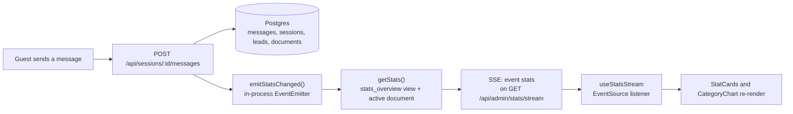

# Admin dashboard

The `/admin` page shows how the chatbot is being used and lets an admin replace the knowledge base PDF. It updates
in real time: when a guest sends a message, the numbers and the category chart change within about a second, with no
reload. The page reads from the database on every change, so the numbers are never a client-side guess.

The API contract is in [`ARCHITECTURE.md`](ARCHITECTURE.md) §4 (`GET /api/admin/stats`, `GET /api/admin/stats/stream`).

## What the page shows

Top to bottom, on a 1100 px-wide grid that stacks to one column on phones:

| Area | Content | Source field |
|---|---|---|
| Header | "Admin dashboard" title and a live status badge (**Live**, **Polling**, or **Connecting**) | connection mode |
| Key numbers | Four stat cards: **Total sessions**, **Questions asked**, **Unanswered** (with an *Answer rate NN%* sub-label once there are questions), **Leads captured** | `totalSessions`, `totalQuestions`, `unansweredQuestions`, `totalLeads` |
| Knowledge base | Upload card: current PDF name, pages, chunks, upload time and status pill (Ready, Processing, Failed). Drag-and-drop or a file picker, "Replace PDF", and an error line for failed uploads | `activeDocument` |
| Categories | Horizontal bar chart of questions per category. All eight categories are always shown, zeros included, sorted by count, with value labels | `byCategory` |

Accessibility choices: the chart has a visually hidden table with the same numbers, the live badge is a
`role="status"` region, and the badge's pulse animation is turned off for users who prefer reduced motion.

The admin route is code-split with `React.lazy`, so guests on `/chat` do not download Recharts.

## Stat definitions

These are the exact queries behind the numbers. The `stats_overview` view in
[`infra/db/01-schema.sql`](../infra/db/01-schema.sql) and `apps/api/src/lib/stats.ts` implement them.

| Stat | Counts | Notes |
|---|---|---|
| **Total sessions** | Sessions that have at least one user message | Opening `/chat` creates a session row, but that session does not count until a guest actually asks something. Refreshing the page does not add a session, because the session id is kept in `sessionStorage`. |
| **Questions asked** | All user messages | Includes a question whose assistant reply failed (502). The question is stored before the assistant is called. |
| **Unanswered** | User messages with `answered = false` | Only a question with a verdict counts. A question that failed with 502 has `answered` null and is not counted here. |
| **Answer rate** (UI sub-label) | `(questions − unanswered) / questions` | Computed in the page, not the API. Because the 502 questions are in the denominator and not in the unanswered count, they count as answered in this rate. Treat it as approximate. |
| **Leads captured** | Rows in `leads` | A lead row is kept even when the Resend email fails, so this counts submitted contact forms, not delivered emails. The per-lead `emailStatus` lives in the database. |
| **Questions by category** | User messages with a non-null `category`, grouped by category | Every category in the fixed list of eight is returned, with zeros, sorted by count descending. Ties keep the list order. |
| **Active document** | The document with `is_active = true` | Shown in the upload card. Only one document is active at a time. |

Two definitions to keep in mind when reading the numbers:

- A **session** is a conversation, not a page view. A guest who asks one question and leaves is one session.
- An **unanswered question** is the bot's verdict (`answered = false`), so it includes questions answered with the
  canned "I don't have that information" sentence. It does not include outages.

## Data flow: message to chart

Step by step:

1. **Write.** The API writes the user message, then calls WF2 through n8n, then writes the assistant message. Only
   after that write succeeds does it call `emitStatsChanged()`. Session creation, lead submission, uploads and ingest
   failures also emit.
2. **Event.** `lib/events.ts` is a process-local `EventEmitter`. The API runs as a single process, so this is enough.
   Changing the API to several replicas would need Postgres `LISTEN/NOTIFY` or a similar broadcast.
3. **Snapshot.** Each stream subscriber re-runs `getStats()` (two queries: the `stats_overview` view and the active
   document). The full snapshot is sent, not a diff. At this scale that is simpler and always correct.
4. **Push.** `lib/sse.ts` writes `event: stats` with the JSON snapshot. The stream sends one snapshot as soon as the
   browser connects, then one per change.
5. **Heartbeat.** A `: ping` comment is written every 20 seconds, so nginx, the Cloudflare Tunnel and the browser
   keep the connection open. The response carries `Cache-Control: no-cache`, `X-Accel-Buffering: no` and
   `Connection: keep-alive`, and nginx has `proxy_buffering off` for `/api/`.
6. **Render.** `useStatsStream` (in `apps/web/src/lib/useStatsStream.ts`) listens for `stats` events and replaces its
   state. The Admin page also copies `activeDocument` from each snapshot into the upload card.

Known trade-offs:

- Each change triggers a fresh snapshot without debouncing. A burst of changes produces a burst of events. The page
  only shows the last one, so it is correct but not efficient.
- A failed assistant call (502) inserts the user message but does not emit an event, so that question appears on
  the dashboard at the next change, not immediately. The fix is a one-line `emitStatsChanged()` on that path.

## Polling fallback

Real-time delivery depends on a long-lived connection. Some networks and proxies break that, so there is a fallback:

- The hook opens an `EventSource` to `/api/admin/stats/stream`. The browser reconnects by itself after a dropped
  connection.
- Each reconnect error increments a counter. After **2 failed reconnects** the hook closes the `EventSource` and
  switches to **polling**: `GET /api/admin/stats` every **10 seconds**. The badge changes from Live to Polling.
- The switch is one way. The `EventSource` is closed and not reopened, so the page stays on Polling until it is
  reloaded.
- Browsers without `EventSource` go straight to polling.

The **Connecting** state is shown until the first snapshot arrives over either transport.

## Upload and the dashboard

The upload card and the stats share the same data path, so a replaced document appears in the cards straight away:

- Upload runs synchronously, typically 10 to 30 seconds. The card shows *Processing (embedding chunks)…* during that
  time.
- On success the API makes the new document active and deletes the previous PDF file, then emits an event. The
  dashboard receives the new `activeDocument`.
- On failure the document row is marked `failed` with the error text, and the card shows the reason. The previous
  document stays active, so the chatbot keeps working.

## Checking it by hand

1. Open `/admin` in one window and `/chat` in another (or in a second browser profile).
2. Send a question. The **Questions asked** number and the category bar should change within about a second, and the
   badge should read **Live**.
3. Ask something the PDF does not cover. **Unanswered** should go up by one.
4. Stop the API. The badge moves to **Polling** after two reconnect attempts. The page then polls every 10 seconds,
   so once the API is back the numbers catch up on the next poll.

The automated version of steps 1 and 2 is the Playwright spec `apps/e2e/tests/ui/admin-realtime.spec.ts`, which runs
the same flow across two pages. See [`RUNBOOK.md`](RUNBOOK.md#end-to-end-tests-playwright).
